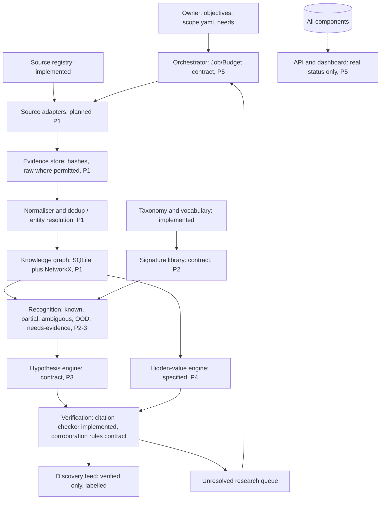

# Master Architecture (v0.1, Phase 0)

Supersedes `starter_pack/SYSTEM_ARCHITECTURE.md` (kept unmodified) and refines it without changing its
objectives. Status markers: **[implemented]** code exists and is tested; **[contract]** typed contract only;
**[specified]** design only; **[planned]** named, not yet designed in detail.

## 1. Vision and measurable success

**Vision (owner's words, directive s13).** "Its success is measured by how much independently verifiable,
previously overlooked and practically valuable knowledge it discovers."

**What that means operationally:**

| Success dimension | Measured by | Phase gate |
|---|---|---|
| Finds useful things conventional retrieval misses | B05: nDCG@5 and novelty@5 against a conventional-search baseline, with blind owner ratings | 4 |
| Never fabricates | B06: 100% traceability, 0 fabricated citations; live re-verification | 1 onward |
| Understands architectures | B01: macro F1 on independent, lineage-split test data | 2 |
| Handles the unknown honestly | B02: unknown recall, false-unknown rate and wrong-identity rate on withheld families | 3 |
| Doesn't cry wolf | B04: false-anomaly rate under ordinary change | 3 |
| Works unattended and survives failure | T10/T11: bounded 24 h/72 h runs; kill-and-restore with no committed-evidence loss | 5, 7 |
| Improves for real | Frozen-set comparison and rollback (T20) | 6 |

**Minimum viable milestone (starter pack roadmap):** one accessible-source pipeline that retrieves real
documentation, records evidence, discovers an obscure useful tool, explains its ranking and recovers from an
interrupted job. Phases 1 and 4 are scoped so that this milestone arrives before the complex novelty models.

## 2. Design principles

1. **Evidence first.** Claims carry citations with quotes that are checked live. Analysis is labelled as analysis.
2. **Unknown is a valid output.** It is never silently mapped to the nearest known class, and never promoted to "new network".
3. **Ordinary explanations first.** Every anomaly hypothesis lists measurement error, version change and incomplete data before anything novel.
4. **Local-first, cheap first.** Stdlib/SQLite/CPU baselines before services or GPUs.
5. **Scope is explicit.** Every limit appears in SCOPE_AND_RESTRICTIONS.md, separated into hard limits and choices.
6. **Ingested content is data.** It never becomes instructions, configuration or code.
7. **Real status only.** The system never shows simulated activity as real execution.

## 3. Layered model of what Abyss studies

The taxonomy vocabulary separates, as MASTER_AUDIT s2 requires:
`physical → link → network → transport → overlay → application → information_ecosystem`. A recognised
"system" usually spans several layers (e.g. Tor: overlay plus information ecosystem). The distinction stops
category errors such as treating the Web (application/ecosystem) as the Internet (network).

## 4. Components

| Module | Path | Input | Output | Status |
|---|---|---|---|---|
| Data contracts | `abyss/core/contracts.py` | — | Source, Citation, RetrievalRecord, Observation, Signature, Hypothesis, Finding, Tool, Job | [implemented] v0.1.0 |
| Scope policy | `abyss/core/scope.py`, `config/scope.yaml` | Source | ScopeDecision with reason | [implemented] minimal |
| Source registry | `abyss/foundation/registry.py`, `data/registry/` | YAML | Validated, versioned Source records | [implemented] |
| Taxonomy | `abyss/foundation/taxonomy.py`, `data/taxonomy/` | YAML | Validated taxonomy; cross-references | [implemented] |
| Retrieval | `abyss/foundation/fetch.py` | URI | RetrievalRecord plus bytes (bounded, paced, classified failures) | [implemented] |
| Citation verifier | `abyss/foundation/citations.py` | Taxonomy, registry | Citation report (per-quote outcome) | [implemented] |
| Reachability probe | `abyss/foundation/probe.py` | Registry, scope | Probe report | [implemented] |
| Benchmark pre-registration | `abyss/foundation/benchmarks.py`, `data/benchmarks/` | YAML | Validated definitions | [implemented] |
| Doc generator | `abyss/foundation/render.py` | YAML/CSV/reports | Generated Markdown (drift-tested) | [implemented] |
| Source adapters | `abyss/sources/` | Registered source | Provenanced documents | [planned P1] |
| Evidence store and KG | `abyss/storage/` | Records | SQLite tables with migrations; graph projection | [planned P1] |
| Signature engine | `abyss/intelligence/signatures.py` | Docs | Versioned Signature records | [contract] P2 |
| Recognition | `abyss/intelligence/recognition.py` | Feature records | Label from {known, partial, ambiguous, out_of_distribution, needs_evidence} plus uncertainty | [specified] P2–3 |
| Hypothesis and verification | `abyss/research/` | Observations | Hypothesis/Finding with status history | [contract] P3 |
| Hidden-value engine | `abyss/intelligence/value.py` | Needs, KG | Ranked Tools with explanations | [specified] P4 |
| Orchestrator | `abyss/research/orchestrator.py` | Objective, scope, budget | Checkpointed Jobs | [contract] P5 |
| API and UI | `abyss/api/`, `abyss/ui/` | Stored state | Real status, evidence | [planned P5] |

## 5. Data contracts (v0.1.0)

Defined as Pydantic models in `abyss/core/contracts.py`. Records are immutable and reject unknown fields.
Rules of evidence enforced by types (tested in `tests/unit/test_contracts.py`):

- `Citation` quotes are verbatim (no ellipses), at least 8 characters, and point to a registered source.
- `Source` states `access_basis`; a `restricted` source can't be an ingestion endpoint; `terms_verified` requires `terms_uri`.
- `RetrievalRecord`: success needs a SHA-256; failure needs an error. Outcomes include `blocked` and `rate_limited`, which never count as success.
- `Observation` and `Hypothesis` carry a mandatory `RecordScope` (real_world / laboratory / synthetic / fixture).
- `Hypothesis` requires at least one alternative explanation and at least one falsification condition. `refuted` requires contradicting evidence.
- `Finding`: `verified` requires evidence and a method; real-world verified findings need at least 2 distinct corroborating sources; fixtures can never be verified; retractions keep their reason.
- `Job`: attempts bounded by budget; `running`/`failed` require timestamps and errors.

Contract changes bump `CONTRACT_VERSION` and need a migration note in CHANGELOG.md.

## 6. Role of the LLM (D-014)

Optional (Ollama, local). It may propose extractions, summaries, candidate hypotheses and query expansions.
It may **not** decide a classification, a verification outcome or a citation. Its outputs are stored as
`analysis` with model id and prompt hash until corroborated. The pipeline must work with it disabled (T19).
Prompts never include configuration-changing authority, and document text is passed as quoted data.

## 7. Storage and knowledge graph (D-005)

Phase 1: SQLite with explicit migrations (stdlib `sqlite3`, or SQLAlchemy if migrations warrant it), WAL mode,
and atomic transactions per job step. Tables: sources, retrievals, documents (content hash, optional raw blob
path), observations, entities, relations (with valid-from/valid-to and evidence ids), claims, hypotheses,
findings, review events, jobs, checkpoints, audit events. Contradictions are first-class: a relation may have
both supporting and contradicting evidence, and neither is deleted. NetworkX projections are built for analysis
and are never the source of truth.

## 8. Discovery strategy (summary; see DISCOVERY_ENGINE_SPECIFICATION.md)

Abyss doesn't start from a search box. It expands a graph from seeds (the owner's needs, taxonomy entries,
curated lists) along **structural links that search ranking ignores**: dependency edges in package registries,
citation edges in literature, forge cross-references, archived link targets and RFC/draft references. It then
scores candidates on documented usefulness for a stated need, maintenance, licence and cost, and measures
obscurity separately (so obscurity is reported, but never rewarded for its own sake).

## 9. Recognition strategy (summary; see SIGNATURE_SPECIFICATION.md)

Observations in Phase 2 are documentation-derived feature records (D-003 option A, pending approval). Features
follow the taxonomy vocabulary (topology, resource identification, discovery, patterns). Open-set behaviour is
evaluated by withholding whole families (B02). Laboratory traffic in owned environments is a proposed second
modality for Phase 3.

## 10. Deployment and dependencies

| Dependency | Version tested | Licence | Purpose | Phase |
|---|---|---|---|---|
| Python | 3.13.18 (requires ≥ 3.11) | PSF | runtime | 0 |
| pydantic | 2.13.5 | MIT | contracts | 0 |
| PyYAML | 6.0.3 | MIT | data files | 0 |
| pypdf (optional) | 6.17.0 | BSD-3-Clause | PDF text | 0 |
| poppler `pdftotext` (optional) | system | GPL (separate process) | PDF text fallback | 0 |
| pytest (dev) | 9.1.1 | MIT | tests | 0 |
| FastAPI, SQLAlchemy, scikit-learn, NetworkX | not yet installed | MIT/BSD | API, storage, ML, graph | 1–2 |

Licences above are as commonly published for these projects and haven't been re-checked in Phase 0. A lock file
and a container image arrive in Phase 1 (R23). Resource use so far: one full live citation run takes about 47 s of
wall time, 58 retrievals and about 6.5 MB downloaded (2026-11-24 run), using under 5 s of CPU.
