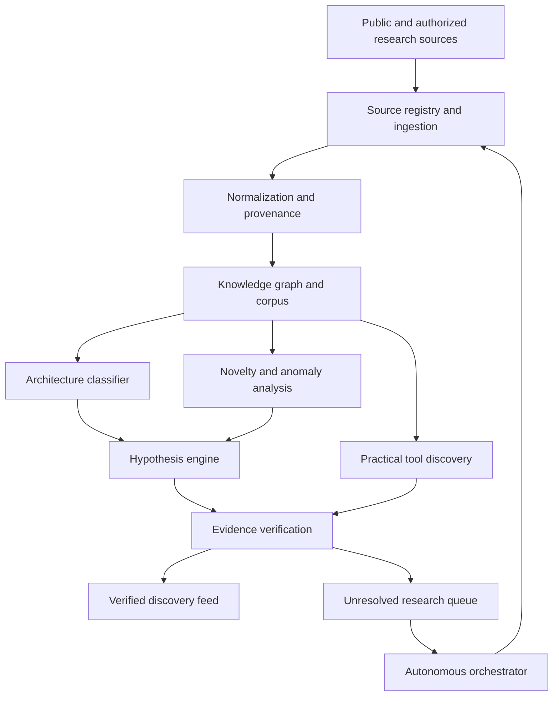

# Project Abyss — System Architecture

## Design principles
Local-first, evidence-first, reproducible, modular, transparent scope. Unknown is a valid output. Build a research platform, not an access-bypass utility.

## Data flow


## Modules and interfaces
| Module | Input | Output |
|---|---|---|
| Source registry | Source metadata and permissions | Versioned source record |
| Ingestion | Registered accessible source | Provenanced document or dataset |
| Normalizer | Raw record | Canonical observation |
| Signature engine | Public specs and lab observations | Versioned architecture features |
| Recognition | Feature record, model version | Known/unknown label and uncertainty |
| Hypothesis | Observations and context | Claim, alternative, falsifier |
| Verification | Hypothesis and evidence | Finding status with reasons |
| Value ranking | Tool metadata and user objective | Utility ranking with explanation |
| Orchestrator | Objective, scope and budget | Checkpointed research job |
| UI/API | Stored state | Real status and evidence |

## Data contracts
- Source: id, URI, access basis, license, retrieval time, reliability notes.
- Observation: id, source id, content hash, timestamp, extracted features, quality flags.
- Signature: id, architecture family, feature definition, provenance, version, limitations.
- Hypothesis: id, observation ids, claim, alternatives, proposed test, falsification conditions, status.
- Finding: id, hypothesis id, evidence ids, confidence rationale, status, review history.
- Tool: id, project name, documented capabilities, availability, license, cost, maintenance, usefulness evidence.
- Job: id, objective, allowed source scope, budget, status, attempts, checkpoint, timestamps.

## Implementation layout
```
abyss/
  core/           # typed contracts, configuration, events
  sources/        # public/authorized dataset and document adapters
  storage/        # SQLite, migrations, evidence persistence
  intelligence/   # classification, novelty, ranking
  research/       # hypotheses, verification, orchestration
  api/            # FastAPI endpoints
  ui/             # research dashboard
  tests/          # unit, integration, end-to-end and benchmarks
  docs/           # architecture, audit and research reports
```

## Initial stack
Python 3.11+, SQLite, SQLAlchemy, Pydantic, FastAPI, NetworkX, scikit-learn and optional local Ollama. Pin versions after compatibility testing. Start with simple baselines before neural models. Store large datasets outside the repository with manifests and checksums. Upgrade storage only after measured limits.

## Failure and trust model
Ingested documents are untrusted. No document can redefine execution scope or invoke tools. Job limits, retries and stop signals must work even when the model fails. Persist partial results atomically. Keep synthetic and live research records separate. Avoid collecting private information outside permission. Log source failures, model failures, rejected claims and unavailable resources.

## Research datasets and references
- CAIDA data catalog: https://www.caida.org/catalog/datasets/
- RIPE RIS: https://ris.ripe.net/
- RFC Editor: https://www.rfc-editor.org/
- IETF Datatracker: https://datatracker.ietf.org/
- Tor specifications: https://spec.torproject.org/
- I2P documentation: https://geti2p.net/en/docs
- IPFS documentation: https://docs.ipfs.tech/

These are candidate references, not claims that datasets have been downloaded or their current access terms verified. Check access and licensing before ingestion.
